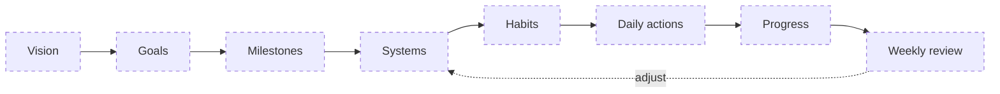

# AshuOS

**Big ambitions stay vague when nothing connects them to what I do each day.**

AshuOS is a personal life-design system: *build the life you envision.* It turns a vision into goals, goals into milestones and systems, and systems into daily actions. Then it tracks whether those actions add up to real progress, and makes room for a weekly reflection. It's one Flutter app for Android, iOS, macOS, Windows and the web.

**[Read the project story](docs/project-story.md)**: the problems, decisions and fixes behind AshuOS, in SOART format.

## How it works

Planned. Everything in AshuOS follows one chain:

**Vision → Goals → Milestones → Systems → Habits → Daily actions → Progress → Reflection**

A vision describes who I want to become. Goals make it measurable, systems and habits make it repeatable, and daily actions are what actually gets done. An image on the Vision Board is inspiration only: it never counts as progress. Suggested routines are proposals, and nothing gets scheduled until I approve it.

This section gets filled in as phases A–C land.

## Status

Every screen is built on sample data first (phases A–E); the Supabase backend comes after.

| Phase | | |
|---|---|---|
| A Design foundation | ⏳ | Docs set up. Next: the Flutter app, the emerald dark theme, design tokens, typography, components and breakpoints |
| B Application shell | | Desktop sidebar, mobile bottom bar with a More screen, page transitions, settings |
| C Core experience | | Dashboard, Vision Board and vision detail, Life Systems, goals and milestones |
| D Hobbies | | Hobby overview, the five hobby cards, a page for each hobby |
| E Supporting modules | | Fitness, academics, career, finance, personal growth, calendar, experience library, insights, weekly review |
| Backend | | Supabase auth, database schema, migrations, row-level security, real repositories |
| Integration | | Real data everywhere, analytics, performance, polish |

## Architecture

Solid boxes and arrows are built; dashed ones are planned. **[All architecture diagrams](docs/architecture.md)**.

The order comes from the spec. How the pieces link to each other, and how progress flows back up the chain, is still open and gets its own ADR.

## Key decisions

No ADRs yet. Each non-obvious decision gets an ADR in [docs/adr/](docs/adr/) and a row here.

| ADR | Decision | Why |
|---|---|---|

## Repository layout

| Path | Contents |
|---|---|
| `docs/` | [Project story](docs/project-story.md), [ADRs](docs/adr/) and [architecture diagrams](docs/architecture.md) |
| `.github/` | The pull request template |
| `LOG.md`, `NEXT.md`, `BACKLOG.md` | Build log (one line per session), the next single task, parked ideas |

The Flutter app (`lib/`, `test/` and the platform folders) arrives with phase A.

## Running locally

You need Flutter 3.50 (Dart 3.14). The commands to run the app and its tests go here once the app is scaffolded.
