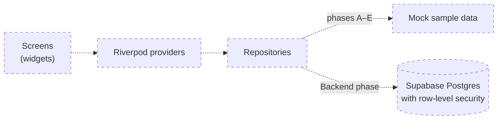

# AshuOS architecture diagrams

## Summary (SOART)

- **Scenario:** AshuOS turns a personal vision into goals, systems and daily actions, and tracks the progress they create, in one Flutter app for mobile, desktop and web.
- **Obstacle:** nothing is built yet, and the relationships between the pieces of the chain are still being designed.
- **Action:** one diagram per view of the system, drawn from the code as it is. Solid lines and boxes are built; dashed ones are planned.
- **Result:** so far, the chain from the spec and the planned data flow. Both are planned.
- **Troubleshooting:** the diagrams are only useful while they're accurate, so they're updated at the end of every phase, alongside the README.

**Contents**

1. [The life-design chain](#1-the-life-design-chain)
2. [Planned data flow](#2-planned-data-flow)

---

## 1. The life-design chain

The order of the chain comes from the spec. Still open: whether each link is one-to-many or many-to-many, and what changes up the chain when a daily action is completed. It gets its own ADR once decided.

## 2. Planned data flow

Phases A–E read mock repositories filled with realistic sample data; Supabase replaces them in the Backend phase. Where the business logic (progress maths, routine suggestions) sits in this flow is still open.

